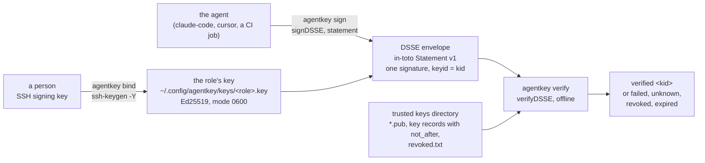
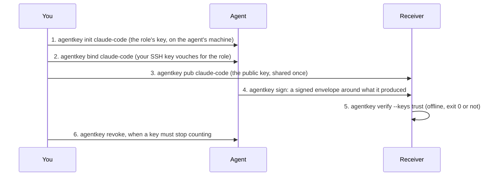
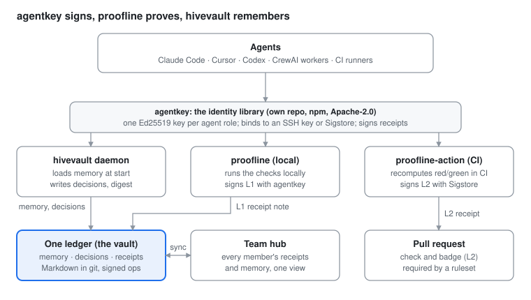
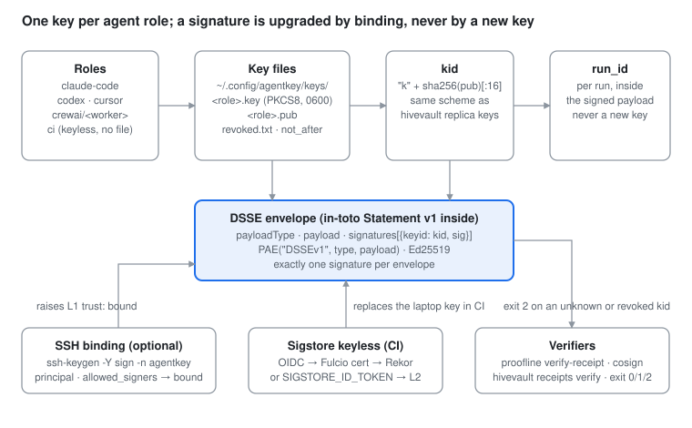

# agentkey

**One key per AI agent role. Every artefact the agent signs says which role made it, on which machine, bound to which person.**

Coding agents act under a person's accounts: they commit as you, open pull requests as you, write files as you. When something turns out wrong, nothing in the record says which agent did it, whether it ran on your machine, or whether a person stood behind it. agentkey gives each agent role on a machine its own Ed25519 key, signs what the agent produces as a DSSE envelope or an in-toto Statement, verifies those signatures offline against a directory of trusted keys with revocation and expiry, and binds the role's key to the person's SSH key so the chain ends at a human. No runtime dependencies (`node:crypto`; keyless Sigstore signing uses the optional `@sigstore/sign`), Node 22+, Apache-2.0.



## Sixty seconds

One command creates the role's key on the agent's machine, and the agent signs from then on:

```bash
npx @optitransfer/agentkey@next init claude-code        # once per role per machine: "<kid> claude-code created"
```

Hand the agent this and nothing else:

```bash
echo '{"task":"TASK-1","status":"done"}' | npx @optitransfer/agentkey@next sign claude-code --type application/json > report.dsse.json
```

Whoever receives `report.dsse.json` checks it against the keys they trust, offline:

```bash
npx @optitransfer/agentkey@next pub claude-code > trust/claude-code.pub   # the agent's public key, shared once
npx @optitransfer/agentkey@next verify --keys trust < report.dsse.json     # "verified <kid>", exit 0
```

Exit codes: `0` verified, `1` a trusted key's signature does not verify, `2` an unknown, revoked or expired key or missing input, `3` usage. Every command takes `--json`. To tie the role to yourself, once: `npx @optitransfer/agentkey@next bind claude-code --principal you@example.com` signs the role's public key with your SSH key, and anyone with your `allowed_signers` line can check the binding with OpenSSH alone.

## The problem, and how you use it

Your agents act as you. They commit as you, open pull requests as you, write reports as you. When something turns out wrong, the record says "you" and nothing else: not which agent, not which machine, not whether a person stood behind it. And a report an agent wrote can be edited by anyone before it reaches you.

agentkey fixes the record. Each agent role on a machine gets its own key. The agent signs what it produces. Anyone who receives it can check, offline, three things: which role signed it, that it has not been altered since, and which person's SSH key vouched for that role. No account, no server, no network.

Three parties: **you** (the person), **the agent** (Claude Code, Cursor, a CI job) and **the receiver** (a reviewer, a pipeline, Proofline).



| Step | Who | What happens | Command |
|---|---|---|---|
| 1 | You | Create the role's key on the agent's machine, once per role. The key stays there, file mode 0600, never copied. | `npx @optitransfer/agentkey@next init claude-code` |
| 2 | You | Vouch for the role with your own SSH key. The binding says "this person stands behind this role on this machine". | `npx @optitransfer/agentkey@next bind claude-code --principal you@example.com` |
| 3 | You | Give the receiver the role's public key, once. That is all the receiver ever needs. | `npx @optitransfer/agentkey@next pub claude-code > trust/claude-code.pub` |
| 4 | Agent | Sign what it produced. Any bytes in, a DSSE envelope out, with one signature whose id names the role's key. | `... \| npx @optitransfer/agentkey@next sign claude-code --type application/json` |
| 5 | Receiver | Verify against the keys it trusts. Exit 0 means: this role, unaltered, vouched for. Exit 1 means the signature does not verify. Exit 2 means an unknown, revoked or expired key. | `npx @optitransfer/agentkey@next verify --keys trust < report.dsse.json` |
| 6 | You | Stop a key from counting. A revoked key fails verification from then on, with exit code 2 and its kid named. | `npx @optitransfer/agentkey@next revoke claude-code` |

Steps 1 to 3 in one command, on the agent's machine:

```bash
npx @optitransfer/agentkey@next setup claude-code --principal you@example.com   # "<kid> claude-code bound to you@example.com, trusted in ./trust"
```

`agentkey setup` creates the role's key if there is none, binds it with your SSH key (`~/.ssh/id_ed25519`, or `--ssh-key <path>`), and writes into `./trust` (or `--trust <dir>`) the four files a receiver needs: the role's public key, its binding (`.pub.sshsig`, `.pub.principal`) and your `allowed_signers` line. It checks everything before it writes anything, so a missing SSH key, an `ssh-keygen` older than OpenSSH 8.0 or a trust directory it cannot write stops it with the missing piece named and nothing created. It never replaces a key or a binding, and running it again changes nothing. A passphrase-protected SSH key needs `ssh-add` first, or a terminal to type the passphrase on; without either it stops at once rather than wait on a prompt. It prints the one line the agent signs with; `--json` prints `{ role, kid, principal, trust, sign }`.

What the signature does not prove: that the agent did good work. It proves who produced the artefact and that nobody changed it afterwards. Judging the work is what Proofline does, and it uses these signatures to say which agent its receipts are about.

## Why

A signature from a shared account proves nothing about who acted. A key per agent role fixes the unit of accountability at the role on a machine: `claude-code` on your laptop is one key, `claude-code` in CI is another, a review role a third. The key never leaves the machine, is never replaced by accident (`init` on an existing role reports its key and never replaces it), and is refused by `load` when its file mode is wrong. Revocation is a line in the trusted keys directory's `revoked.txt` (`agentkey revoke` writes it into `keys/` on the signing machine; a receiver adds the line to its own); expiry is a date in the key record; both are checked at verification time, so a stolen or retired key stops verifying without touching the artefacts it signed.

The envelope is the standard one: DSSE with the in-toto Statement v1 inside, so the same artefact verifies with agentkey, with the sigstore verifier (`@sigstore/verify`, tested in `test/interop.test.mjs`), or with any DSSE verifier, and a receipt produced by [proofline](https://github.com/mgillr/proofline) or any other tool can carry it. The binding to a person uses OpenSSH's own signature format (`ssh-keygen -Y`), so it is checked with tools everyone has.

## What a signature proves

A key at rest is readable by every process of the user who owns it, so one agent can sign as another role on the same machine. A signature identifies the user's machine key set for that role, not the agent process; the binding adds the person behind that key set. `AGENTKEY_SIGNER=ssh-agent`, which keeps the private key in the agent instead of a file, is a later option.

## How it fits



## Inside the key



## Reference

### Keys

```js
import { generate, load, kid } from '@optitransfer/agentkey';

const { kid: id, publicKey } = generate('claude-code');   // once per role per machine
const key = load('claude-code');                          // { role, kid, publicKey, privateKey }
kid(publicKey) === id;                                    // true
```

- `generate(role)` creates the role's keypair and returns `{ kid, publicKey }`, the public key as the base64url of its 32 raw bytes (the form hivevault stores as a replica key). It never replaces an existing key: a second call throws `AGENTKEY_EXISTS`.
- `load(role)` returns `{ role, kid, publicKey, privateKey }` with `privateKey` a `KeyObject`. It throws `AGENTKEY_MISSING` when the role has no key, and `AGENTKEY_INSECURE` when the key file's mode is not 0600 or the file is a symbolic link.
- `kid(publicKey)` takes a `KeyObject`, a PEM string, the base64url form or the 32 bytes.

A key lives at `$XDG_CONFIG_HOME/agentkey/keys/<role>.key` (PKCS8 PEM, mode 0600), with the public key beside it as `<role>.pub` (SPKI PEM). An unset or relative `XDG_CONFIG_HOME` means `~/.config`. On Windows the home is `%APPDATA%/agentkey`. `AGENTKEY_HOME` overrides either. A role is a string you choose, such as `claude-code`, `codex`, `cursor`, `gemini-cli` or `crewai/<worker>`; each `/` in it is a directory, so `crewai/research:lead` is `keys/crewai/research:lead.key`. A part of a role that is empty, `.` or `..`, or that holds a backslash or a control character is refused (`AGENTKEY_ROLE`). On Windows the characters it does not allow in a file name (`<>:"|?*`), and `%`, are written as `%XX`, because a `:` there opens an alternate data stream.

Windows has no POSIX file modes, so `load` does not check the mode there; the key is protected by the user's access control on `%APPDATA%`.


### Envelopes and Statements

```js
import { load, signDSSE, verifyDSSE, statement } from '@optitransfer/agentkey';

const key = load('claude-code');
const st = statement([{ name: 'app.tgz', digest: { sha256: '...' } }], 'https://example.com/predicate/v1', { ok: true });
const env = signDSSE('application/vnd.in-toto+json', JSON.stringify(st), key);
const r = verifyDSSE(env, [key.publicKey]);   // { ok, verified, unknown, failed, payloadType, payload }
```

- `signDSSE(payloadType, payload, key)` signs the DSSE pre-authentication encoding (`pae`) of the type and the payload with the role's Ed25519 key and returns an envelope with exactly one signature, whose `keyid` is the key's kid. The payload is a string or bytes; the envelope carries it as base64.
- `verifyDSSE(envelope, keys)` checks every signature against the trusted keys, given as Ed25519 public keys in any form `kid` takes, or as `{ kid, publicKey }` for a key of another type (it verifies ECDSA P-256 too, which is what DSSE's own test vector uses). Each signature's kid lands in `verified`, `unknown` (no trusted key has that keyid) or `failed` (a trusted key whose signature does not verify). `ok` is true only when at least one signature verified and none failed: a failed signature for a known key fails the whole result, and is never skipped. `payload` holds the bytes that were verified, decoded once, so use those rather than reading the envelope again. Standard and URL-safe base64 are both accepted.
- `statement(subjects, predicateType, predicate)` returns an in-toto Statement v1, `{ _type: "https://in-toto.io/Statement/v1", subject, predicateType, predicate }`; each subject needs a non-empty `digest` map.


### Keys that are never trusted

Eight points of the Ed25519 curve have a small order, and under one of them a signature made with no private key verifies: under the identity key, one fixed value passes for every message. Node imports those keys and accepts that value. agentkey refuses them wherever a public key enters (`kid`, the trusted keys of `verifyDSSE`, a trust directory for `agentkey verify --keys`, `bindingMessage`) with `AGENTKEY_UNSAFE_KEY`, as libsodium does: its table of the seven blocked encodings, a second spelling of a point (a y at or past 2^255 - 19, or a base64url string with nonzero padding bits), and 32 bytes that are no point of the curve. `publicKeyProblem(bytes)` says which, or `null`. The check is the one hivevault applies to its replica keys.

### Commit trailers

```js
import { trailer } from '@optitransfer/agentkey';

trailer(key.kid, process.env.GITHUB_RUN_ID);   // "Agent-Key: k…\nAgent-Run: 123456"
```

The two lines go in the last paragraph of a commit message an agent role made (or through `git commit --trailer`), so `git interpret-trailers --parse` and any reviewer can read which role's key and which run produced it. A kid that is not `k` and 16 hex, or a run id with a space or a line break, is refused, so neither can open another trailer.

### Command line

```sh
agentkey init claude-code                     # once per role; prints "<kid> claude-code created"
agentkey pub claude-code > trust/claude-code.pub
echo '{"ok":true}' | agentkey sign claude-code --type application/json > env.json
agentkey verify --keys trust < env.json       # "verified <kid>", exit 0
agentkey revoke claude-code                   # the key moves to revoked/, its kid is listed in keys/revoked.txt
```

| Command | Does |
| --- | --- |
| `init [role]` | Creates the role's key. The role defaults to `AGENTKEY_ROLE`, else `agent`. An existing key is reported (`created: false`) and never replaced. |
| `list` | Every role that has a key, with its kid, and the kids in `keys/revoked.txt`. |
| `pub <role>` | The role's public key as SPKI PEM. |
| `sign <role> --type <payloadType>` | Signs stdin and writes the DSSE envelope to stdout. |
| `verify --keys <dir> [--at <date>]` | Verifies the DSSE envelope on stdin against the keys in `<dir>`. |
| `bind <role> --principal <id> [--ssh-key <path>]` | Signs the role's public key with your SSH key (default `~/.ssh/id_ed25519`); see below. |
| `revoke <role>` | Appends `<kid> <ISO date>` to `keys/revoked.txt`, then moves the key, its `.pub` and its binding to `revoked/<kid>.key`, `.pub`, `.pub.sshsig` and `.pub.principal`. |

Every command takes `--json` and then writes one JSON object to stdout, errors included (`{ "ok": false, "reason", "error" }`). The exit codes are:

| Code | Meaning |
| --- | --- |
| 0 | ok |
| 1 | verification failed: a trusted key's signature does not verify |
| 2 | an unknown, revoked or expired key, or missing input (empty stdin, no key for the role, an unreadable keys directory) |
| 3 | usage |

The keys directory for `verify` holds `*.pub` files (SPKI PEM, or the base64url of the 32 raw bytes) and `*.json` key records `{ "publicKey": ..., "not_after": "<ISO date>" }`, read recursively, and `revoked.txt` at its top. The role's own `keys/` directory is one. `verify` reports, in this order: `failed` (exit 1), then `revoked` and `expired` (exit 2) when a signature verified from a key that `revoked.txt` lists or whose `not_after` has passed, then `verified` (exit 0), then `unknown` (exit 2). A signature that names a revoked kid whose key is no longer in the directory counts as revoked. A key record that cannot be read, or a `not_after` that is not an ISO date, is an error (exit 2), so a limit is never dropped without notice. Two files for one key keep the earlier `not_after`.

A DSSE signature carries no date, so `not_after` is checked against the time of verification, which is now unless `--at` names another, such as the time a trusted log recorded the envelope. A date written next to the signature would not be signed, and the holder of the key could backdate it.


### Binding the role to a person

```sh
agentkey bind claude-code --principal ana@example.com --ssh-key ~/.ssh/id_ed25519
```

```js
import { bind, verifyBinding } from '@optitransfer/agentkey';

bind('claude-code', '/home/ana/.ssh/id_ed25519', 'ana@example.com');
verifyBinding('/home/ana/.config/agentkey/keys/claude-code.pub', '/home/ana/.ssh/allowed_signers');
// { status: 'bound', kid, principal: 'ana@example.com' }
```

`bind(role, sshKeyPath, principal)` runs `ssh-keygen -Y sign -n agentkey -f <sshKey>` over the agent's public key and stores the signature as `<role>.pub.sshsig` and the principal as `<role>.pub.principal`, beside `<role>.pub`. The SSH key can be a private key, or a public key whose private half is in ssh-agent. `verifyBinding(pub, allowedSignersPath, principal?)` runs `ssh-keygen -Y verify -n agentkey -I <principal> -f <allowedSigners>` and returns `status` `bound` (it verifies), `unbound` (there is no `.sshsig`) or `invalid` (there is one and it does not verify: tampered, made by a key the file does not allow, for another principal, or over a different agent key), with `reason` holding what ssh-keygen said. The principal is the one stored beside the key unless you pass one. ssh-keygen does the signing and the checking, so the signature format and the `allowed_signers` rules, `namespaces=` included, are OpenSSH's. This needs OpenSSH 8.0 or later; without ssh-keygen on `PATH`, `bind` throws `AGENTKEY_SSH_UNAVAILABLE`.

The signed message is the agent public key as the base64url of its 32 raw bytes followed by a newline, the `publicKey` that `agentkey pub <role> --json` prints, so you can check a binding with OpenSSH alone:

```sh
agentkey pub claude-code --json | jq -r .publicKey \
  | ssh-keygen -Y verify -n agentkey -I ana@example.com -f ~/.ssh/allowed_signers -s claude-code.pub.sshsig
```

An `allowed_signers` line for this is `ana@example.com namespaces="agentkey" ssh-ed25519 AAAA...`. `agentkey revoke` moves the binding files to `revoked/` with the key.

### Keyless signing with Sigstore (optional)

```js
import { signKeyless } from '@optitransfer/agentkey';

const { envelope, bundle } = await signKeyless('application/vnd.in-toto+json', JSON.stringify(st));
```

`signKeyless(payloadType, payload, { identityToken?, fulcioURL?, rekorURL? })` signs the payload as a DSSE envelope with a short-lived Fulcio certificate issued for the CI job's OIDC identity, and records it in Rekor. It returns the envelope and the Sigstore bundle (v0.3 JSON) that carries the envelope with its verification material, which `cosign verify-blob-attestation --bundle bundle.json --new-bundle-format` checks. The identity token is `identityToken` when you pass one, else the GitHub Actions OIDC token (the job needs `permissions: id-token: write`), else `SIGSTORE_ID_TOKEN` on any other CI. It is read before anything is sent; with none, `signKeyless` throws `AGENTKEY_SIGSTORE_NO_TOKEN`.

It uses `@sigstore/sign`, an optional dependency loaded on the first call. Without it, `signKeyless` throws `AGENTKEY_SIGSTORE_UNAVAILABLE` and the rest of agentkey works as before; install it with `npm install @sigstore/sign` if your package manager skipped it. The URLs default to the public Sigstore instance, where a signature is public and its certificate names the identity that signed: for a GitHub Actions job, the repository and the workflow.

`.github/workflows/sigstore-interop.yml` signs a fixture Statement this way and verifies it with cosign in the same job. It runs only when started by hand, because of that public record.

## Repository layout

```text
agentkey/
├── bin/agentkey.mjs     the command: init, list, pub, sign, verify, bind, revoke
├── src/index.mjs        keys (generate, load, kid), DSSE (pae, signDSSE, verifyDSSE), the Statement builder
├── src/cli.mjs          the command line, --json, exit codes
├── src/bind.mjs         bind and verifyBinding through ssh-keygen -Y
├── src/sigstore.mjs     signKeyless, the optional keyless Sigstore signer
├── test/                one file per feature, run with node --test
└── proofline.json       the contract this repository is built against
```

## Licence

Apache-2.0. See `LICENSE` and `NOTICE`. Contributions are accepted under the same licence with a Developer Certificate of Origin sign-off on each commit.
